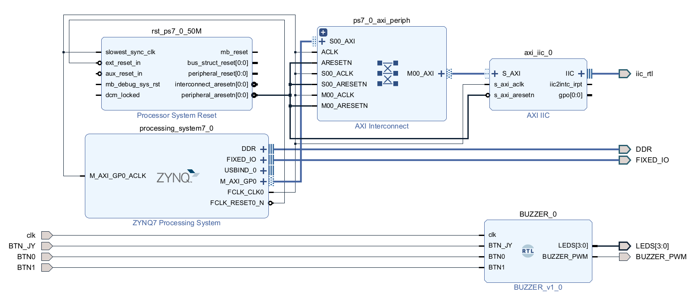

# AYUD10 · I2C Buzzer

> Primera interacción con los periféricos de la tarjeta **Booster**: leer por **I2C** el sensor de temperatura **TMP006** y el de luz **OPT3001**, configurando sus registros según la hoja de datos, y accionar el **buzzer** con una PWM generada desde un IP Core propio.

Ayudante a cargo: **José Agustín Milling** — ja.milling@uc.cl

Esta ayudantía se divide en tres partes:

| | Qué es | Cuándo se hace |
| :--- | :--- | :--- |
| **Actividades previas** | Un *Block Design* con el Zynq7 Processing System, un AXI IIC y el IP Core `BUZZER`, y sobre él un proyecto de Vitis que lee los dos sensores por I2C. | **Antes**, en su casa. |
| **Actividad de la ayudantía** | Una **alarma de temperatura**: agregar un puerto AXI al IP Core `BUZZER` para que el tono se vuelva más agudo a medida que sube la temperatura. | **Durante** la ayudantía. |
| **Problema propuesto** | Un **theremin**: el tono del buzzer cambia según qué tan cerca está la mano del sensor de luz, sin tocarlo. | Se entrega en **Canvas**. |

---

## 🎥 Antes de la ayudantía

Debes llegar a la sesión con las **actividades previas ya desarrolladas y funcionando en la tarjeta**: un proyecto de Vivado con un *Block Design* que incluya el **Zynq7 Processing System** y un **AXI IIC** con el reloj SCL en **100 kHz**; los pines SDA y SCL de la Booster asociados a los de la Zybo, revisando el esquemático de la Booster y descomentándolos en el archivo de *constraints*; y una nueva fuente `BUZZER`, con el código de `BUZZER.vhd`, con entradas `clk`, `BTN0`, `BTN1` y `BTN_JY` (botones de la Booster) y salidas `LEDS` y `BUZZER_PWM`, empaquetada como IP Core e incluida en el diseño. Después, el *HDL Wrapper* y el *bitstream* generados y el `.xsa` exportado. Ya en Vitis, un *Platform Project* creado con ese `.xsa` y un *Application Project* con los archivos `.c` y `.h` de `Archivos.rar`.

Este es el *Block Design* al que se debe llegar:

Estas actividades están resueltas paso a paso en este video, grabado el año **2023 por Reimundo Alcalde, ex ayudante del curso**:

**Apoyarse en el video es opcional.** Puede seguirlo completo, usarlo sólo para destrabar un punto puntual, o resolver las actividades por su cuenta: eso lo decide usted. Lo que no es opcional es llegar con el diseño andando, leyendo los sensores y con el buzzer sonando, porque el tiempo de la ayudantía se destinará por completo a la actividad.

---

## 📂 Material

| Archivo | Descripción |
| :--- | :--- |
| [AYUD10-I2C-Buzzer.pdf](https://github.com/IEE2463-SEP/AYUD10-I2C-Buzzer/blob/HEAD/AYUD10-I2C-Buzzer.pdf) | Enunciado de la ayudantía: objetivos, actividades previas, actividad de la ayudantía y problema propuesto. |
| [block-design.png](https://github.com/IEE2463-SEP/AYUD10-I2C-Buzzer/blob/HEAD/block-design.png) | Diagrama del *Block Design* de las actividades previas (la Figura 1 del enunciado). |
| [Archivos.rar](https://github.com/IEE2463-SEP/AYUD10-I2C-Buzzer/blob/HEAD/Archivos.rar) | Código de las actividades previas: `BUZZER.vhd` (4 tonos y 4 amplitudes), `I2C.c`/`I2C.h` (`read_tmp` y `read_opt`), `Delay.c`/`Delay.h`, `main.c` y las *constraints* `Zybo-Z7-Master.xdc`. |
| [I2C_BUZZER.zip](https://github.com/IEE2463-SEP/AYUD10-I2C-Buzzer/blob/HEAD/I2C_BUZZER.zip) | Proyecto de Vivado de las actividades previas, con el *Block Design* y el *bitstream* ya generados. |
| [TMP006.PDF](https://github.com/IEE2463-SEP/AYUD10-I2C-Buzzer/blob/HEAD/TMP006.PDF) | Hoja de datos del sensor de temperatura TMP006. |
| [opt3001.pdf](https://github.com/IEE2463-SEP/AYUD10-I2C-Buzzer/blob/HEAD/opt3001.pdf) | Hoja de datos del sensor de luz OPT3001: aquí están el registro de resultado y el tiempo de conversión que pide el problema propuesto. |

---

## 🧪 Durante la ayudantía

La **actividad de la sesión** es una **alarma de temperatura**: el buzzer debe avisar cuando el sensor marca valores cercanos a un límite definido por usted, con un tono más agudo mientras mayor sea la temperatura. Como la frecuencia se envía desde el PS, esta vez **sí hay que volver a Vivado** para modificar el IP Core:

**1. Rangos.** Hacer pruebas para determinar la temperatura mínima que marca el sensor y la máxima al acercar el dedo, y elegir un rango de frecuencias apreciables.

**2. IP Core.** Incorporar un puerto AXI al IP Core `BUZZER` y modificar su código para que la frecuencia de la PWM sea la recibida desde el PS.

**3. Vitis.** Una función, por ejemplo `Alertar()`, que reciba la temperatura, la asocie a una frecuencia y la envíe por AXI. A modo de ejemplo, con un rango de 18 °C a 26 °C, una relación lineal entre 200 Hz y 4000 Hz.

> ⚠️ El ciclo de trabajo debe mantenerse siempre en **50 %**: la alarma es de frecuencia, no de amplitud.

---

## 🎵 Problema propuesto

La idea es construir un **theremin**, un instrumento que se toca sin contacto: al acercar la mano al OPT3001 esta tapa la luz y el tono se vuelve **agudo**, y al alejarla se vuelve **grave**.

**1. Rangos.** Medir cuántos lux marca el sensor con la mano lejos y con la mano a unos 2 cm, y elegir un rango de frecuencias apreciables.

**2. Lectura en lux.** Modificar `read_opt()` para que retorne la iluminación en lux y no el registro sin procesar, usando el exponente `E[15:12]` y la mantisa `R[11:0]` del registro `0x00`: `lux = 0.01 · 2^E · R`.

**3. Respuesta rápida.** Revisar en la hoja de datos el tiempo de conversión que establece el mensaje `0xC410` en el registro de configuración `0x01`, y reemplazar el `sleep(1)` del `main` por un retardo coherente con ese tiempo.

**4. IP Core.** Incorporar un puerto AXI al IP Core `BUZZER` para que la frecuencia sea la recibida por AXI en vez de seleccionarse con `BTN1`. `BTN0` sigue siendo el control de volumen (los 4 ciclos de trabajo) y `BTN_JY` el botón de silencio.

**5. Vitis.** Una función `Theremin()` que reciba la iluminación en lux, la asocie a una frecuencia y la envíe por AXI. A modo de ejemplo, de 5 lux (mano casi tocando) a 300 lux (mano lejos), una relación lineal inversa entre 2000 Hz y 200 Hz, saturando a los extremos fuera de ese rango.

> ⚠️ El ciclo de trabajo debe seguir siendo el seleccionado con `BTN0`, independiente de la frecuencia recibida por AXI. Recuerde que en el código de la ayudantía se obtiene desplazando el valor de `FRECUENCIA`.

### 📤 Entrega y bonificación

> 📅 **Plazo excepcional:** como el material se publicó con casi una semana de atraso, el problema propuesto de esta ayudantía se puede subir a **Canvas hasta el viernes 13 de noviembre a las 14:50**.

Entregarlo dentro de plazo otorga **una décima (+0,1)** en la nota del **Proyecto 2**.

---

IEE2463 · Sistemas Electrónicos Programables
